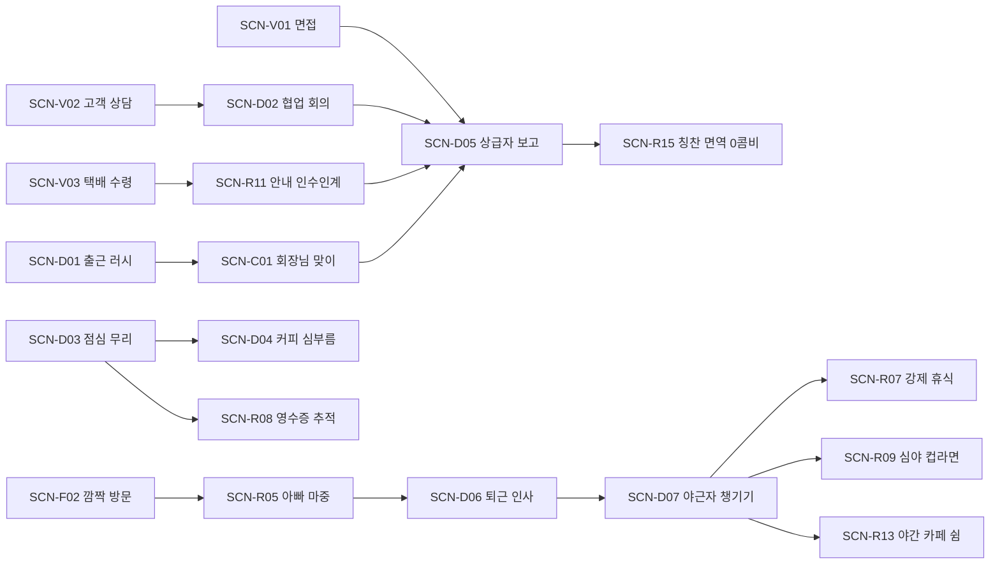

# HANI 빌딩 사무실 장면 대본 v1 (`office-scene-scripts-v1`)

> **작성**: 세린 연구원 (Gemini · AI플랫폼개발실)  
> **관련 데이터 초안**: [office-scenes-v1.json](file:///C:/Users/홍성민/Documents/HANI_OS_DEV_CLAUDE/p4b/docs/drafts/office-scenes-v1.json)  
> **기반 규칙**: [AGENTS.md](file:///C:/Users/홍성민/Documents/HANI_OS_DEV_CLAUDE/p4b/AGENTS.md) · [office-behavior-engine-v2.md](file:///C:/Users/홍성민/Documents/HANI_OS_DEV_CLAUDE/p4b/docs/design/office-behavior-engine-v2.md) · [character-bible-v1.md](file:///C:/Users/홍성민/Documents/HANI_OS_DEV_CLAUDE/p4b/docs/drafts/character-bible-v1.md) · [character-bible-m9-mir.md](file:///C:/Users/홍성민/Documents/HANI_OS_DEV_CLAUDE/p4b/docs/character-bible-m9-mir.md) · [kids-character-guide-v1.md](file:///C:/Users/홍성민/Documents/HANI_OS_DEV_CLAUDE/p4b/docs/drafts/kids-character-guide-v1.md)  
> **운영 제약**: `localStorage` 저장 변경 없음(0회) · AI 실시간 호출 없음(0회) · 순간이동 퇴장 없음 · 기존 포즈/장소 데이터 기준

---

## 회장님 체크리스트 (넣기 / 빼기 선택표)

> 아래 34개 장면 중 넣고 싶은 것만 `[넣기]`, 빼고 싶은 것은 `[빼기]`에 표시해 주시면 그대로 반영하겠습니다. (쉬운 말 한 줄 설명)

| 번호 | ID | 한 줄 설명 | 선택 |
|---|---|---|---|
| 1 | `SCN-V01` | 면접 보러 온 손님이 1층에서 안내받고 부서 팀장님과 면접한 뒤 걸어서 나가는 모습 | `[ ] 넣기` / `[ ] 빼기` |
| 2 | `SCN-V02` | 계약·미팅 손님이 오면 1층에서 맞이하고 담당 직원이 내려와 상담한 뒤 배웅하는 모습 | `[ ] 넣기` / `[ ] 빼기` |
| 3 | `SCN-V03` | 택배 기사님이 상자를 가져오면 1층 프론트에서 확인하고 택배함에 넣은 뒤 인사하는 모습 | `[ ] 넣기` / `[ ] 빼기` |
| 4 | `SCN-V04` | 점심·야근 시간에 배달 음식이 오면 주문한 직원이 1층으로 내려가 받아 오는 모습 | `[ ] 넣기` / `[ ] 빼기` |
| 5 | `SCN-V05` | 지나가던 손님이 1층 카페에서 커피 한 잔을 시켜 받아 들고 걸어 나가는 모습 | `[ ] 넣기` / `[ ] 빼기` |
| 6 | `SCN-D01` | 아침에 직원들이 1층 로비 인사를 받고 엘리베이터로 올라가 자기 자리에 앉는 모습 | `[ ] 넣기` / `[ ] 빼기` |
| 7 | `SCN-D02` | 팀장님이 회의를 부르면 직원들이 회의실에 모여 이야기를 맞추고 자기 자리로 돌아가는 모습 | `[ ] 넣기` / `[ ] 빼기` |
| 8 | `SCN-D03` | 점심시간에 친한 직원들끼리 서로 부르며 2층 팬트리·1층·6층 옥상으로 밥 먹으러 가는 모습 | `[ ] 넣기` / `[ ] 빼기` |
| 9 | `SCN-D04` | 오후에 한 명이 층 주문을 모아서 1층 카페에 사 와 책상마다 나눠 주는 커피 심부름 모습 | `[ ] 넣기` / `[ ] 빼기` |
| 10 | `SCN-D05` | 일을 마친 직원이 회장님 방이나 팀장님 자리로 가서 보고하고 칭찬·피드백을 듣는 모습 | `[ ] 넣기` / `[ ] 빼기` |
| 11 | `SCN-D06` | 퇴근 시간에 옆 동료와 1층 안내원에게 인사한 뒤 정문으로 걸어서 퇴근하는 모습 | `[ ] 넣기` / `[ ] 빼기` |
| 12 | `SCN-D07` | 밤에 남아 일하는 직원에게 따뜻한 차를 건네며 잠깐 쉬었다 가라고 챙겨 주는 모습 | `[ ] 넣기` / `[ ] 빼기` |
| 13 | `SCN-N01` | 아침 7시·저녁 7시에 1층 편의점 점원(다솜·나래)이 서로 인계하고 바통을 넘기는 모습 | `[ ] 넣기` / `[ ] 빼기` |
| 14 | `SCN-N02` | 아침 9시·저녁 6시에 1층 안내데스크(소담·하람)가 일정표를 넘기며 교대하는 모습 | `[ ] 넣기` / `[ ] 빼기` |
| 15 | `SCN-N03` | 아침 7시·저녁 7시에 1층 카페 바리스타(이슬·은하)가 원두·차 상태를 넘기며 교대하는 모습 | `[ ] 넣기` / `[ ] 빼기` |
| 16 | `SCN-C01` | 회장님이 출근하시면 4층 비서실과 하니 전무가 반갑게 맞이하고 오늘 일정을 전하는 모습 | `[ ] 넣기` / `[ ] 빼기` |
| 17 | `SCN-C02` | 회장님이 잠시 안 계실 때 4층에서 하니와 가은이 조용히 안건과 일정을 맞춰 두는 모습 | `[ ] 넣기` / `[ ] 빼기` |
| 18 | `SCN-F01` | 주말에 아빠와 수현·수연 남매가 5층 라운지에서 강아지·고양이들과 어울려 쉬는 모습 (점수·경쟁 없음) | `[ ] 넣기` / `[ ] 빼기` |
| 19 | `SCN-F02` | 평일 저녁 수현이나 수연이 학교를 마치고 아빠 보러 깜짝 들러 안기고 함께 퇴근하는 모습 | `[ ] 넣기` / `[ ] 빼기` |
| 20 | `SCN-R01` | `[드문 장면]` 늦은 밤 4층 보드 앞에서 하니와 서윤이 로드맵을 맞추며 웃는 모습 | `[ ] 넣기` / `[ ] 빼기` |
| 21 | `SCN-R02` | `[드문 장면]` 오후 5층 도서관에서 히나와 윤슬이 몰래 소설책 보다가 딱 10분만 더 보기로 하는 모습 | `[ ] 넣기` / `[ ] 빼기` |
| 22 | `SCN-R03` | `[드문 장면]` 3층 아린 자리에서 유리가 "예쁜데 모바일에서도 눌려요?" 하고 꼼꼼히 확인하는 모습 | `[ ] 넣기` / `[ ] 빼기` |
| 23 | `SCN-R04` | `[드문 장면]` 금요일 6층 옥상에서 민지가 감동샷 찍으려다 하니 전무한테 딱 들키는 모습 | `[ ] 넣기` / `[ ] 빼기` |
| 24 | `SCN-R05` | `[드문 장면]` 퇴근 무렵 수현·수연 남매가 함께 4층 회장실 문을 두드리며 산책 가자고 조르는 모습 | `[ ] 넣기` / `[ ] 빼기` |
| 25 | `SCN-R06` | `[드문 장면]` 강아지 식빵(또는 크림)이 나은이나 히나를 졸졸 따라와서 2층 산책을 하는 모습 | `[ ] 넣기` / `[ ] 빼기` |
| 26 | `SCN-R07` | `[드문 장면]` 야근하는 수아나 도연을 나은이 2층 팬트리로 데려가 허브차 마시게 하고 퇴근시키는 모습 | `[ ] 넣기` / `[ ] 빼기` |
| 27 | `SCN-R08` | `[드문 장면]` 하루가 편의점에서 신상 간식을 고르다 지은 부장에게 영수증을 들켜 한 봉지만 허락받는 모습 | `[ ] 넣기` / `[ ] 빼기` |
| 28 | `SCN-R09` | `[드문 장면]` 심야에 도연과 세린이 1층 편의점에서 나래가 끓여 준 컵라면을 함께 먹는 모습 | `[ ] 넣기` / `[ ] 빼기` |
| 29 | `SCN-R10` | `[드문 장면]` 5층 스튜디오에서 수연·민지·유나가 대본 없이 즉흥 NG 컷을 찍으며 웃는 모습 | `[ ] 넣기` / `[ ] 빼기` |
| 30 | `SCN-R11` | `[드문 장면]` 오전 1층 안내데스크 소담의 방문 일지를 유나와 가은이 내려와 직접 받아 올라가는 모습 | `[ ] 넣기` / `[ ] 빼기` |
| 31 | `SCN-R12` | `[드문 장면]` 6층 옥상에서 미르가 "왜 지금 산책해요?" 묻자 수연이 "가보면 알아" 하고 답하는 모습 | `[ ] 넣기` / `[ ] 빼기` |
| 32 | `SCN-R13` | `[드문 장면]` 밤 카페에서 하품하는 바리스타 은하에게 채원이 순한 차를 청하고 미르가 곁을 지키는 모습 | `[ ] 넣기` / `[ ] 빼기` |
| 33 | `SCN-R14` | `[드문 장면]` 오후 2층 팬트리에서 나은·지은·이음이 잠깐 모여 차 마시며 눈을 쉬는 모습 | `[ ] 넣기` / `[ ] 빼기` |
| 34 | `SCN-R15` | `[드문 장면]` 회장님 칭찬 소식을 듣고 하니와 수아 둘 다 쑥스러워서 서로 미루다가 빠르게 자리로 도망가는 모습 | `[ ] 넣기` / `[ ] 빼기` |

---

## 1. 하루 일과표 (평일 07:00~24:00 · 새벽 경계 · 주말)

### 1-1. 평일 하루 흐름 (`weekday`)

| 시간대 | 구간 이름 | 일어나는 일 | 연결 장면 ID |
|---|---|---|---|
| `06:55 ~ 07:10` | 이른 아침 카운터 교대 | 야간 점원 나래·은하가 주간 다솜·이슬에게 1층 편의점과 카페를 넘기고 정문으로 걸어 퇴근 | `SCN-N01`, `SCN-N03` |
| `08:30 ~ 09:15` | 출근 러시 & 프론트 교대 | 직원들이 1층 로비 인사(하람→09시 소담 교대)를 지나 엘리베이터로 올라가 자기 자리에 착석 | `SCN-D01`, `SCN-N02`, `SCN-C01` |
| `09:15 ~ 11:45` | 오전 집중 · 보고 · 회의 · 방문객 | 회장님 출근 인사/부재 조율, 부서별 회의, 상급자 보고, 면접·고객·택배·아침 커피 손님 응대 | `SCN-C01`, `SCN-C02`, `SCN-D02`, `SCN-D05`, `SCN-V01`, `SCN-V02`, `SCN-V03`, `SCN-V05`, `SCN-R11` |
| `11:45 ~ 13:30` | 점심 무리 이동 & 배달 피크 | 단짝끼리 2층 팬트리·1층 편의점·6층 옥상 테라스로 점심 이동, 배달 기사 수령, 간식 영수증 해프닝 | `SCN-D03`, `SCN-V04`, `SCN-V05`, `SCN-R08` |
| `13:30 ~ 17:30` | 오후 집중 · 커피 심부름 · 크리에이티브 | 층별 오후 커피 심부름, 면접·고객 상담, 상급자 보고, 5층 도서관·스튜디오 및 희귀 장면 발동 | `SCN-D04`, `SCN-D02`, `SCN-D05`, `SCN-V01`, `SCN-V02`, `SCN-V03`, `SCN-V05`, `SCN-C02`, `SCN-R02`, `SCN-R03`, `SCN-R04`, `SCN-R06`, `SCN-R10`, `SCN-R12`, `SCN-R14`, `SCN-R15` |
| `17:30 ~ 19:05` | 퇴근 인사 · 아빠 마중 · 야간 교대 | 정시 퇴근 웨이브, 수현·수연 하교 방문/마중, 안내(18시 소담↔하람)·편의점/카페(19시) 교대 | `SCN-D06`, `SCN-R05`, `SCN-F02`, `SCN-N02`, `SCN-N01`, `SCN-N03` |
| `19:05 ~ 24:00` | 야근자 케어 · 심야 간식 · 조용한 쉼 | 야근 잔류 인원(서윤·도연·미르·유나·민지 등) 작업, 나은·나래·은하의 야근자 돌봄, 심야 희귀 장면 | `SCN-D07`, `SCN-V04`, `SCN-R01`, `SCN-R07`, `SCN-R09`, `SCN-R13`, `SCN-F02` |
| `00:00 ~ 06:55` | 심야 마감 & 새벽 당직 경계 | `00~01시` 컵라면 마무리, `02:00` 일반 잔업자 퇴근 경계 후 1층 야간 3인(나래·하람·은하)과 4층 미르 상주 | `SCN-R09`, `SCN-N01`, `SCN-N02`, `SCN-N03` |

### 1-2. 주말 하루 흐름 (`weekend`)

| 시간대 | 구간 이름 | 일어나는 일 | 연결 장면 ID |
|---|---|---|---|
| `07:00 ~ 12:00` | 주말 오픈 & 가족 라운지 시작 | 1층 24시간 카운터 정상 교대, 테이크아웃 손님 방문, 10시부터 회장님·수현·수연 5층 키즈·펫 라운지 | `SCN-N01`, `SCN-N02`, `SCN-N03`, `SCN-V05`, `SCN-F01` |
| `12:00 ~ 18:00` | 주말 라운지 · 옥상 산책 · 동물 교감 | 남매와 펫·마스코트 어울리기(경쟁·점수 0), 배달 간식, 주말 산책·옥상 대화 | `SCN-F01`, `SCN-V04`, `SCN-V05`, `SCN-R06`, `SCN-R12` |
| `18:00 ~ 24:00` | 주말 저녁 귀가 & 야간 카운터 유지 | 가족 걸어서 귀가, 18시/19시 야간 카운터 교대(하람·나래·은하), 심야 당직 전환 | `SCN-N02`, `SCN-N01`, `SCN-N03`, `SCN-V04`, `SCN-V05` |

---

## 2. 장면 설계 원칙 · 5요소 · 기존 자산 제약

### 2-1. 모든 장면의 5요소 & 다인 만남 5단계 순서
1. **시작 조건 (`trigger`)**: 요일(`weekday`/`weekend`/`daily`), 시간창, 확률, 앞선 장면(`afterScene`), 건물·좌석 가용 조건을 모두 만족할 때만 시작한다.
2. **출연자 (`roles`)**: 고정 배역, 부서/층별 후보 풀, 우선순위를 적고 **1인 1장면(`perActorMaxConcurrent = 1`)**을 지킨다.
3. **대본 (`beats`)**: 다인이 만나는 장면은 반드시 **`다가감(approach) → 마주 봄(face) → 대사(talk) → 리액션(reaction) → 헤어짐(disperse)`** 순서를 지키며, 1줄 대사는 **32자 내외 / 2~4초**로 유지한다.
4. **예외 처리 (`fallback`)**: 대상자가 회의·외근·부재중이거나 목표 좌석이 만석이면, **빈 의자 앞에서 혼자 말하다 사라지지 않고** 대리인 연결·대기석 안내·대체 장소 이동·안전 취소(`cancel()`) 중 하나로 처리한다.
5. **퇴장 (`exit`)**: 모든 방문객·교대 퇴근자·직원은 화면에서 갑자기 사라지지 않고 **출입문·복도·엘리베이터·`arrival_gate`까지 걸어서 이동(`walk-a`/`walk-b`)**한다.

### 2-2. 기존 데이터 준수 · 신규 표시 목록

- **포즈 제한**: 직원/방문객/NPC는 `sitting`, `standing`, `walk-a`, `walk-b`만 사용한다. 아이(`kid-suhyeon`, `kid-suyeon`)는 `wave`, `seat-b`, `startled`, `cling` 및 기본 이동 포즈를 사용한다.
- **미르(`mir`) 전용 규칙**: 4층 `mir_station` 기반이며 모든 장면·회의·카페 동행에서 **항상 `standing`** 상태를 유지한다. 의자에 앉거나 음식/음료를 먹지 않는다.
- **호칭·톤·가족 보호**: 직원은 성민을 항상 **`회장님`**, 수현·수연은 **`아빠`**로 부른다. 외모·연애·사내 경쟁·아이들 간 우열/투표/호감도 점수는 넣지 않는다.
- **신규 장소 표시 (`NEW:이름`)**: 기존 `spatial-contract-v3.json` / `residentPosts`에 없어 추가 제안하는 6개 지점은 아래처럼 표시한다.
  - `NEW:post_shift_wait_store` (1F 편의점 카운터 앞 교대 인계 대기 지점 — 교대 시 2인 겹침 방지)
  - `NEW:post_shift_wait_reception` (1F 안내데스크 옆 교대 인계 대기 지점)
  - `NEW:post_shift_wait_cafe` (1F 카페 카운터 옆 교대 인계 대기 지점)
  - `NEW:conv_checkout_front` (1F 편의점 계산대 정면 손님 줄 지점 — `resident_post_store`와 마주 보기용)
  - `NEW:delivery_dropoff_1f` (1F 안내데스크 옆 배달 음식 임시 보관 선반 지점)
  - `NEW:companion_bread` (회장님 반려견 `식빵` 전용 개체 슬롯 — 1차 아트 미확보 시 기존 `pet-dog` 크림으로 대체 가능)
- **신규 소품·모션 표시 (`[그림 필요]`)**:
  - `[그림 필요: 방문객 명찰]` (`SCN-V01`), `[그림 필요: 택배 상자]` (`SCN-V03`), `[그림 필요: 배달 봉투]` (`SCN-V04`), `[그림 필요: 테이크아웃 컵]` (`SCN-V05`), `[그림 필요: 커피 캐리어]` (`SCN-D04`), `[그림 필요: 허브티 컵]` (`SCN-D07`), `[그림 필요: 식빵(chairmanDog) 스프라이트]` (`SCN-R06`), `[그림 필요: 간식 바구니]` (`SCN-R08`), `[그림 필요: 컵라면]` (`SCN-R09`), `[그림 필요: 필름 카메라]` (`SCN-R04`), `[그림 필요: 스튜디오 카메라]` (`SCN-R10`), `[그림 필요: 방문 일지]` (`SCN-R11`)

---

## 3. 장면 목록 34개 상세 대본

### 그룹 A. 방문객 5종 (`visitor`)

#### `SCN-V01` 면접 지원자 맞이 → 안내 → 부서별 면접 → 배웅
- **시작 조건**: 평일 `10:00~16:00` · 확률 `0.65` (일 `0~2회`) · 1F 상담실 또는 부서 지정 면접실 빈 좌석 존재 · 부서별 면접관 후보 1인 이상 재실
- **출연자**:
  - `guest`: `visitor:candidate` (`arrival_gate` 입장, 날짜 시드로 지원 부서 결정)
  - `greeter`: `npc-guide` (소담, 1F 안내데스크 고정)
  - `interviewer` (부서별 면접관 후보 & 면접실):
    - **전략기획실(`strategy`)**: `hani` → `gaeun` → `ieum` (기본 `1F client_booth`, 동행 시 `4F exec_meeting`)
    - **AI플랫폼개발실(`platform`)**: `seoyun` → `yuri` → `dohyun` → `serin` → `arin` (기본 `1F client_booth`, 동행 시 `3F release_room`)
    - **재무회계실(`finance`)**: `jieun` → `haru` → `daon` (기본 `1F client_booth`, 동행 시 `2F shared_meeting_2f`)
    - **라이프&엔터테인먼트실(`life`)**: `naeun` → `hina` → `minji` (기본 `1F client_booth`, 동행 시 `2F shared_meeting_2f`)
    - **기업솔루션사업부(`business`)**: `sua` → `taeo` (기본 `1F client_booth`, 동행 시 `2F shared_meeting_2f`)
- **대본 (5단계)**:
  1. *(다가감)* `guest` → `arrival_gate` (`walk-a`): `"안녕하세요, 면접 보러 왔습니다."`
  2. *(다가감)* `guest` → `reception` (`standing`): `"오늘 10시 면접 지원자입니다."`
  3. *(마주 봄)* `greeter` → `resident_post_reception` (`standing`): `"반갑습니다! [그림 필요: 방문객 명찰] 여기 명찰 드릴게요."`
  4. *(대기 착석)* `guest` → `client_booth_slot_1` (`sitting`): `"안내 감사합니다. 면접 대기 중… 두근"`
  5. *(다가감·마주 봄)* `interviewer` → `client_booth_slot_2` (`sitting`): `"오래 기다리셨죠? 오늘 면접 담당입니다."`
  6. *(대사)* `guest` → `client_booth_slot_1` (`sitting`): `"아닙니다! 잘 부탁드립니다!"`
  7. *(대사)* `interviewer` → `client_booth_slot_2` (`sitting`): `"지원하신 계기와 강점을 편하게 말씀해 주세요."`
  8. *(대사)* `guest` → `client_booth_slot_1` (`sitting`): `"문제를 구조화해서 끝까지 해내는 편입니다."`
  9. *(리액션)* `interviewer` → `client_booth_slot_2` (`standing`): `"오늘 말씀 잘 들었습니다. 조심히 들어가세요!"`
  10. *(헤어짐)* `interviewer` → `door_consult` (`walk-a`): `"소담님, 면접 마쳤습니다. 배웅 부탁드려요."`
- **예외 처리**:
  - 1순위 면접관이 P0~P3 회의 중이면 같은 부서 2순위 후보가 내려온다.
  - 해당 부서 전원 부재 시 `yuna` 또는 `gaeun`이 `client_booth`에서 사전 질문지를 접수한다.
  - `client_booth` 4석이 모두 차 있으면 소담이 `lobby-nw` 소파 대기 안내 후 공석 발생 시 이동시킨다.
- **퇴장**: 지원자는 `door_consult` → `hall_consult` → `reception` 앞 목례 후 `arrival_gate`까지 걸어 나간다. 면접관은 `elevator_1f`로 자기 부서 자리로 걸어 복귀한다.
- **연결**: `SCN-D05` (면접 결과 상급자 보고)

#### `SCN-V02` 방문 고객 접수 → 호스트 마중 → 상담 → 배웅
- **시작 조건**: 평일 `10:00~17:00` · 확률 `0.7` (일 `1~3회`) · 상담실 공석 존재
- **출연자**: `guest`(`visitor:client`), `greeter`(`npc-guide`), `host`(`sua` → `taeo` → `jieun` → `hani` 순 가용자)
- **대본**:
  1. *(다가감)* `guest` → `reception` (`standing`): `"안녕하세요, 기업솔루션 미팅 예약했습니다."`
  2. *(마주 봄)* `greeter` → `resident_post_reception` (`standing`): `"어서 오세요! 바로 담당자분 연결해 드릴게요."`
  3. *(대기 착석)* `guest` → `client_booth_slot_1` (`sitting`): `"네, 상담실에서 기다리고 있겠습니다."`
  4. *(다가감·마주 봄)* `host` → `client_booth_slot_2` (`sitting`): `"안녕하세요, 요구사항 세 가지부터 맞춰볼게요."`
  5. *(대사)* `guest` → `client_booth_slot_1` (`sitting`): `"이번 달 안에 일정과 증빙 기준을 확인하고 싶어요."`
  6. *(대사)* `host` → `client_booth_slot_2` (`sitting`): `"Owner와 기한 정리해서 오늘 안에 메일 드릴게요."`
  7. *(리액션·헤어짐)* `host` → `door_consult` (`standing`): `"와주셔서 감사합니다! 엘리베이터 앞까지 배웅할게요."`
- **예외 처리**: `sua`·`taeo`가 모두 회의 중이면 `lobby-sw` 대기 안내 + 바리스타 이슬 차 제공, 10분 이상 지연 시 `yuna`/`ieum`이 1차 메모를 접수한다.
- **퇴장**: 고객은 `arrival_gate`로 걸어 퇴장하고, 호스트는 엘리베이터를 타고 2F 홈 좌석(`finance-row-spare` / `finance-row-spare-east`)으로 걸어 복귀한다.
- **연결**: `SCN-D02`, `SCN-D05`

#### `SCN-V03` 택배 기사 도착 → 프론트 확인 → 택배함 보관 → 배웅
- **시작 조건**: 매일 `09:00~18:00` · 확률 `0.8` (일 `1~2회`) · `parcel_box` 및 `approach_parcel_box` 가용
- **출연자**: `guest`(`visitor:courier`), `receiver`(`npc-guide` 우선, 부재 시 `yuna` → `npc-clerk-day`)
- **대본**:
  1. *(다가감)* `guest` → `parcel_box` (`standing`): `"[그림 필요: 택배 상자] HANI 그룹 택배 도착했습니다!"`
  2. *(다가감·마주 봄)* `receiver` → `approach_parcel_box` (`standing`): `"수고 많으세요! 수령인 확인 도와드릴게요."`
  3. *(대사)* `guest` → `parcel_box` (`standing`): `"여기 개발실·경영층 물품 두 상자 두고 갈게요."`
  4. *(리액션)* `receiver` → `approach_parcel_box` (`standing`): `"서명 확인했어요. 안전운전하세요!"`
  5. *(헤어짐)* `receiver` → `resident_post_reception` (`walk-a`): `"유나님께 택배 도착 알림 넘겨둬야지."`
- **예외 처리**: 소담이 다른 방문객 응대 중이면 `yuna` 또는 편의점 `npc-clerk-day`(다솜)가 대신 `approach_parcel_box`로 나와 서명한다. 전원 순간 부재 시 `parcel_box` 보관 후 30초 내 확인.
- **퇴장**: 기사는 `arrival_gate`로 걸어 퇴장, 수령자는 포스트로 도보 복귀.
- **연결**: `SCN-D05`, `SCN-R11`

#### `SCN-V04` 배달 기사 도착 → 데스크 확인 → 주문 직원 수령
- **시작 조건**: 매일 `11:30~13:30` 또는 `17:30~21:30` · 확률 `0.75` (일 `1~2회`) · 재실 직원 1명 이상
- **출연자**: `guest`(`visitor:rider`), `desk`(`npc-guide` 09~18시 / `npc-desk-night` 18~09시), `orderer`(시간대 재실 직원 중 1인: `dohyun`, `serin`, `minji`, `sooyeon`, `yuna`, `haru`, `sua` 등)
- **대본**:
  1. *(다가감)* `guest` → `reception` (`standing`): `"[그림 필요: 배달 봉투] 주문하신 음식 배달 왔습니다!"`
  2. *(마주 봄)* `desk` → `resident_post_reception` (`standing`): `"감사합니다! 주문하신 분 지금 내려오실 거예요."`
  3. *(다가감·마주 봄)* `orderer` → `approach_reception` (`standing`): `"저예요! 감사합니다, 맛있게 먹을게요!"`
  4. *(리액션)* `guest` → `reception` (`standing`): `"네, 맛있게 드세요! 수고하세요!"`
  5. *(헤어짐)* `orderer` → `elevator_1f` (`walk-a`): `"동료들이랑 나눠 먹으러 올라가자!"`
- **예외 처리**: 주문자가 15초 내 하강 불가하면 데스크 NPC가 대신 수령해 `NEW:delivery_dropoff_1f`에 임시 보관한다.
- **퇴장**: 기사는 `arrival_gate`로 걸어 퇴장, 주문 직원은 2F 팬트리(`pantry_2f`) 또는 홈 층으로 걸어 올라간다.
- **연결**: `SCN-D03`, `SCN-D07`

#### `SCN-V05` 테이크아웃 손님 → HANI Coffee 주문·수령 → 퇴장
- **시작 조건**: 매일 `09:00~21:30` · 확률 `0.85` (일 `2~4회`) · `coffee_counter` 가용
- **출연자**: `guest`(`visitor:generic`), `barista`(`npc-barista-iseul` 07~19시 / `npc-barista-eunha` 19~07시)
- **대본**:
  1. *(다가감)* `guest` → `coffee_counter` (`standing`): `"안녕하세요, 아이스 아메리카노 한 잔 주세요."`
  2. *(마주 봄·대사)* `barista` → `resident_post_cafe` (`standing`): `"네, 오늘 새로 볶은 원두로 맛있게 내려드릴게요!"`
  3. *(리액션)* `guest` → `coffee_pickup` (`standing`): `"[그림 필요: 테이크아웃 컵] 향이 정말 좋네요. 감사합니다!"`
  4. *(헤어짐)* `barista` → `resident_post_cafe` (`standing`): `"좋은 하루 보내세요! 또 오세요~"`
- **예외 처리**: 카운터가 사내 직원 2명으로 차 있으면 `approach_coffee_pickup`에서 10초 대기 후 주문한다. 은하가 야간 졸음 상태면 기상 리액션 후 정상 응대한다.
- **퇴장**: 손님은 `door_cafe` → `arrival_gate`까지 걸어서 나간다.
- **연결**: `SCN-N03`

---

### 그룹 B. 직원 일상 7개 (`daily`)

#### `SCN-D01` 출근 러시: 로비 인사 → 엘리베이터 탑승 → 자리 착석
- **시작 조건**: 평일 `08:30~09:15` · 확률 `1.0` (일 `3`웨이브) · 평일 고정 뼈대
- **출연자**: `commuters`(날짜 시드로 2~3명씩 소그룹 웨이브 배정, `mir` 제외), `desk_greeter`(`npc-desk-night` 08:30~09:00 / `npc-guide` 09:00 이후)
- **대본** *(대표 앵커 예시 `dev-lead`·`side_desk_seoyun`, 실행 시 각 출연자 홈 좌석으로 매핑)*:
  1. *(다가감)* `commuters[0]` → `arrival_gate` (`walk-a`): `"좋은 아침이에요!"`
  2. *(마주 봄)* `desk_greeter` → `resident_post_reception` (`standing`): `"안녕하세요! 오늘도 좋은 하루 되세요."`
  3. *(이동)* `commuters[0]` → `elevator_1f` (`walk-b`): `"감사합니다, 올라가 볼게요!"`
  4. *(리액션)* `commuters[0]` → `side_desk_seoyun` *(출연자 `side_desk_<id>`)* (`standing`): `"다들 잘 주무셨어요? 오늘 일정 시작하죠!"`
  5. *(헤어짐·착석)* `commuters[0]` → `dev-lead` *(출연자 홈 좌석)* (`sitting`): `"오늘 할 일부터 차근히 열어보자."`
- **예외 처리**: `elevator_1f` 대기 인원이 3명을 넘으면 4번째 출근자는 `stairs_1f`로 분산하거나 15초 뒤 다음 웨이브로 이동한다.
- **퇴장**: 각 직원이 자기 `homeAnchor`에 착석해 기본 업무 상태로 전환한다.
- **연결**: `SCN-C01`, `SCN-D02`

#### `SCN-D02` 부서·협업 회의 소집: 주최자 호출 → 참석자 집결 → 논의 → 해산
- **시작 조건**: 평일 `10:00~11:30` 또는 `14:00~16:30` · 확률 `0.85` · 회의실 공실 존재
- **출연자**: `organizer`(`hani`, `seoyun`, `jieun`, `sua`, `naeun` 중 1인), `attendees`(부서원·협업 파트너 2~4명; `mir` 포함 시 4F `mir_meeting_pos` 배정)
- **대본**:
  1. *(다가감)* `organizer` → `meeting-nw` (`sitting`): `"지금 2층 협업실로 잠깐 모이실까요?"`
  2. *(다가감)* `attendees[0]` → `meeting-ne` (`sitting`): `"네, 바로 내려갈게요!"`
  3. *(마주 봄)* `attendees[1]` → `meeting-sw` (`sitting`): `"자료 챙겨 왔습니다."`
  4. *(대사)* `organizer` → `meeting-nw` (`sitting`): `"핵심 범위 세 가지만 맞춰보고 각자 진행하죠."`
  5. *(리액션)* `attendees[0]` → `meeting-ne` (`sitting`): `"좋아요, 담당이랑 기한 체크했습니다!"`
  6. *(헤어짐)* `organizer` → `door_team_meeting` (`walk-a`): `"수고하셨어요! 각자 자리에서 이어갑시다."`
- **예외 처리**: P0~P2 점유자는 소집에서 제외한다. 2F `shared_meeting_2f` 사용 중이면 3F `release_room` 또는 4F `exec_meeting`으로 장소를 대체한다.
- **퇴장**: 1.5초 시차로 문을 나와 엘리베이터·복도를 통해 홈 좌석으로 도보 복귀한다.
- **연결**: `SCN-D05`, `SCN-R03`

#### `SCN-D03` 점심 무리 이동: 단짝 모으기 → 식당/팬트리/테라스 → 복귀
- **시작 조건**: 평일 `11:50~13:10` · 확률 `1.0` (평일 점심 고정 뼈대)
- **출연자**: `leader`(날짜 시드로 2~3무리 리드 선출), `companions`(`office-places-v3.json`의 `companions` 가중치 + 날짜 시드로 1~2명 조합; `mir`는 식사 제외·대화 동행만 가능)
- **대본**:
  1. *(다가감·마주 봄)* `leader` → `approach_desk_hina` *(동반자 `approach_desk_<id>`)* (`standing`): `"점심시간이에요! 같이 먹으러 갈래요?"`
  2. *(대사)* `companions[0]` → `pantry_2f` (`standing`): `"좋아요! 오늘은 2층 팬트리 아니면 옥상 어때요?"`
  3. *(대사)* `leader` → `rooftop_table_slot_1` (`sitting`): `"바람 좋으니까 옥상 테라스에 자리 잡자!"`
  4. *(리액션)* `companions[0]` → `rooftop_table_slot_2` (`sitting`): `"오늘 도시락이랑 간식 조합 딱 좋네요ㅎㅎ"`
  5. *(헤어짐)* `leader` → `door_terrace` (`walk-a`): `"잘 먹었다! 오후 일하러 내려가요."`
- **예외 처리**: 옥상 테이블 만석 시 2F `pantry_2f`/`finance-lounge-a` → 1F `convenience_browse` → 1F `lobby-nw` 순으로 이동. 단짝이 면접·상담 중이면 같은 층 빈 인원과 2인 조합을 재구성한다.
- **퇴장**: 식사를 마친 무리는 엘리베이터로 각자 홈 좌석으로 걸어 복귀한다.
- **연결**: `SCN-D04`, `SCN-R08`

#### `SCN-D04` 오후 커피 심부름: 주문 모으기 → 1F 카페 주문 → 배달
- **시작 조건**: 평일 `13:30~16:00` · 확률 `0.75` · 1F `coffee_counter` 가용 · 바리스타 이슬 재실
- **출연자**: `runner`(`yuna`, `ieum`, `dohyun`, `haru`, `taeo`, `sooyeon` 중 시드 1인), `barista`(`npc-barista-iseul`), `requesters`(심부름자와 같은 층 동료 1~2명)
- **대본**:
  1. *(다가감·마주 봄)* `runner` → `approach_desk_serin` *(주문자 `approach_desk_<id>`)* (`standing`): `"저 1층 커피 사러 가는데 드실 거 있어요?"`
  2. *(대사)* `requesters[0]` → `dev-build` *(주문자 홈 좌석)* (`sitting`): `"아이스 아메리카노 한 잔 부탁해요! 고마워요."`
  3. *(다가감·마주 봄)* `runner` → `coffee_counter` (`standing`): `"이슬님, 아메리카노 두 잔이랑 라떼 하나요!"`
  4. *(리액션)* `barista` → `resident_post_cafe` (`standing`): `"[그림 필요: 커피 캐리어] 네, 샷 딱 맞춰서 담아드렸어요!"`
  5. *(리액션·헤어짐)* `runner` → `approach_desk_serin` *(주문자 `approach_desk_<id>`)* (`standing`): `"커피 배달 왔습니다! 맛있게 드세요~"`
- **예외 처리**: 1F 카페 대기열 2명 이상이면 2F `pantry_2f` 추출 루트로 전환한다. 주문자가 회의실로 이동했으면 책상 옆에 두고 쪽지를 남긴 뒤 복귀한다.
- **퇴장**: 심부름 담당자는 자기 홈 좌석으로 걸어 복귀한다.
- **연결**: `SCN-D05`

#### `SCN-D05` 보고하러 윗사람 방 가기: 이동 → 보고 → 피드백 → 복귀
- **시작 조건**: 평일 `09:30~17:30` · 확률 `0.85` · 앞선 장면(`SCN-V01/V02/V03/D02`) 종료 또는 보고 당번 시각 · 상급자 재실
- **출연자**: `reporter`(앞 장면 종료자 또는 날짜 시드 보고 당번), `supervisor`(`seongmin` 회장님 재실 시 우선, 또는 `hani`·`seoyun`·`jieun`·`naeun`·`sua`)
- **대본**:
  1. *(다가감·마주 봄)* `reporter` → `junction_ceo` (`standing`): `"회장님, 방금 정리한 안건 보고드려도 될까요?"`
  2. *(대사)* `supervisor` → `ceo-reserved` (`sitting`): `"네, 들어오세요. 핵심부터 들어보죠."`
  3. *(대사)* `reporter` → `approach_ceo_desk` (`standing`): `"기한이랑 담당자까지 확인해서 세 줄로 정리했습니다."`
  4. *(리액션)* `supervisor` → `ceo-reserved` (`sitting`): `"좋아요, 이대로 갑시다. 수고했어요!"`
  5. *(헤어짐)* `reporter` → `door_ceo` (`walk-a`): `"감사합니다! 바로 실행에 옮기겠습니다."`
- **예외 처리**: 상급자가 순찰·회의로 부재중이면 4F `secretary_desk`(가은) 또는 `desk_yuna`(이음)에 요약을 넘기고 복귀한다(빈 의자 앞 독백 금지).
- **퇴장**: 복도와 엘리베이터를 이용해 자기 홈 좌석으로 걸어 복귀한다.
- **연결**: `SCN-R15`

#### `SCN-D06` 퇴근 인사: 자리 정리 → 동료 인사 → 1F 정문 퇴장
- **시작 조건**: 평일 `17:50~18:40` · 확률 `1.0` · 야근 지정자를 제외한 정시 퇴근 인원
- **출연자**: `leaver`(18시 전후 퇴근 웨이브 1~2명), `colleague`(같은 방/층 동료 `minji`, `haru`, `serin`, `yuna`, `sua` 등 1인), `desk`(`npc-desk-night` 하람 또는 직전 `npc-guide` 소담)
- **대본**:
  1. *(다가감·마주 봄)* `leaver` → `side_desk_minji` *(동료 `side_desk_<id>`)* (`standing`): `"오늘 할 일 다 마쳤어요! 먼저 퇴근하겠습니다."`
  2. *(대사)* `colleague` → `life-c` *(동료 홈 좌석)* (`sitting`): `"고생 많으셨어요! 내일 봬요~"`
  3. *(다가감·마주 봄)* `leaver` → `reception` (`standing`): `"하람님, 오늘도 수고하셨습니다!"`
  4. *(리액션)* `desk` → `resident_post_reception` (`standing`): `"조심히 들어가세요! 내일 뵙겠습니다."`
  5. *(헤어짐·퇴장)* `leaver` → `arrival_gate` (`walk-b`): `"안녕히 계세요~"`
- **예외 처리**: 같은 방 동료가 먼저 모두 퇴근했으면 엘리베이터 앞이나 1F 프론트 하람에게 인사하고 퇴장한다.
- **퇴장**: `arrival_gate`까지 걸어서 화면 밖으로 나간다.
- **연결**: `SCN-D07`, `SCN-R05`

#### `SCN-D07` 야근자 챙기기: 야간 간식·음료 전달 & 휴식 권유
- **시작 조건**: 평일 `20:30~23:30` · 확률 `0.8` · 야근 잔류자 1인 이상 재실
- **출연자**: `caretaker`(`naeun`, `seongmin`, 1F 방문 시 `npc-clerk-night`, `npc-barista-eunha`), `worker`(야근 잔류 중인 `seoyun`, `dohyun`, `yuna`, `minji`, `sua`, `mir` 등)
- **대본**:
  1. *(다가감·마주 봄)* `caretaker` → `approach_desk_seoyun` *(야근자 `approach_desk_<id>`)* (`standing`): `"[그림 필요: 허브티 컵] 늦었네요. 잠깐 물 마시고 숨 돌려요."`
  2. *(대사)* `worker` → `dev-lead` *(야근자 홈 좌석)* (`sitting`): `"감사해요! 딱 요 부분만 마무리하고 들어갈게요."`
  3. *(대사)* `caretaker` → `approach_desk_seoyun` *(야근자 `approach_desk_<id>`)* (`standing`): `"무리하면 내일 더 오래 걸려요. 기지개 한 번만 켜고 가요."`
  4. *(리액션·헤어짐)* `worker` → `side_desk_seoyun` *(야근자 `side_desk_<id>`)* (`standing`): `"네, 스트레칭 한 번 하고 정리할게요!"`
- **예외 처리**: 야근자가 이미 1F 편의점/카페로 내려왔다면 나래나 은하가 카운터 접점에서 따뜻한 음료와 간식을 건넨다.
- **퇴장**: 챙겨준 인물은 자기 자리로 복귀하고, 야근자는 정리 후 귀가하거나 심야 잔류 모드로 이어간다.
- **연결**: `SCN-R07`, `SCN-R09`, `SCN-R13`

---

### 그룹 C. 1F 카운터 고정 NPC 6명 교대 3개 (`npc_counter`)

#### `SCN-N01` HANI 24 편의점 주·야간 교대 (다솜 ↔ 나래)
- **시작 조건**: 매일 `06:57~07:03` (다솜 출근 / 나래 퇴근), `18:57~19:03` (나래 출근 / 다솜 퇴근) · 확률 `1.0`
- **출연자**: `incoming`, `outgoing` (`npc-clerk-day` 다솜 ↔ `npc-clerk-night` 나래)
- **대본**:
  1. *(다가감)* `incoming` → `arrival_gate` (`walk-a`): `"교대 시간 맞춰 왔어요!"`
  2. *(다가감·마주 봄)* `incoming` → `NEW:post_shift_wait_store` (`standing`): `"오늘도 수고 많으셨어요. 교대할게요!"`
  3. *(대사)* `outgoing` → `resident_post_store` (`standing`): `"진열이랑 컵라면 온수 다 채워뒀어요. 잘 부탁해요."`
  4. *(리액션)* `incoming` → `NEW:post_shift_wait_store` (`standing`): `"네, 조심히 들어가세요!"`
  5. *(헤어짐·교대)* `incoming` → `resident_post_store` (`standing`): `"어서 오세요! HANI 24입니다."`
- **예외 처리**: `convenience_browse`에서 손님 응대 중이면 결제 완료까지 최대 20초 대기 후 교대한다(카운터 내부 2인 겹침 금지).
- **퇴장**: 퇴근 점원은 `door_convenience`를 나와 `arrival_gate`까지 걸어서 퇴장한다.
- **연결**: `SCN-R08`, `SCN-R09`

#### `SCN-N02` 1F 안내데스크 주·야간 교대 (소담 ↔ 하람)
- **시작 조건**: 매일 `08:57~09:03` (소담 출근 / 하람 퇴근), `17:57~18:03` (하람 출근 / 소담 퇴근) · 확률 `1.0`
- **출연자**: `incoming`, `outgoing` (`npc-guide` 소담 ↔ `npc-desk-night` 하람)
- **대본**:
  1. *(다가감)* `incoming` → `arrival_gate` (`walk-a`): `"안녕하세요, 교대하러 왔습니다."`
  2. *(다가감·마주 봄)* `incoming` → `NEW:post_shift_wait_reception` (`standing`): `"밤사이 별일 없으셨죠? 교대할게요."`
  3. *(대사)* `outgoing` → `resident_post_reception` (`standing`): `"택배함 기록이랑 방문 일정표 올려뒀어요."`
  4. *(리액션)* `incoming` → `NEW:post_shift_wait_reception` (`standing`): `"확인했습니다! 푹 쉬세요."`
  5. *(헤어짐·교대)* `incoming` → `resident_post_reception` (`standing`): `"HANI 안내데스크입니다."`
- **예외 처리**: 방문객이나 택배가 `reception` 앞에 있으면 안내를 마친 뒤 순차 교대한다.
- **퇴장**: 퇴근 안내원은 로비 문을 지나 `arrival_gate`까지 걸어서 퇴장한다.
- **연결**: `SCN-V01`, `SCN-V03`, `SCN-R11`

#### `SCN-N03` HANI Coffee 바리스타 교대 (이슬 ↔ 은하)
- **시작 조건**: 매일 `06:57~07:03` (이슬 출근 / 은하 퇴근), `18:57~19:03` (은하 출근 / 이슬 퇴근) · 확률 `1.0`
- **출연자**: `incoming`, `outgoing` (`npc-barista-iseul` 이슬 ↔ `npc-barista-eunha` 은하)
- **대본**:
  1. *(다가감)* `incoming` → `arrival_gate` (`walk-a`): `"좋은 아침이에요! / 안녕하세요, 은하예요."`
  2. *(다가감·마주 봄)* `incoming` → `NEW:post_shift_wait_cafe` (`standing`): `"오늘 원두 상태 괜찮나요? 교대할게요!"`
  3. *(대사)* `outgoing` → `resident_post_cafe` (`standing`): `"디카페인 포트랑 시럽 다 채워뒀어요."`
  4. *(리액션)* `incoming` → `NEW:post_shift_wait_cafe` (`standing`): `"고생 많으셨어요! 조심히 가세요~"`
  5. *(헤어짐·교대)* `incoming` → `resident_post_cafe` (`standing`): `"따뜻한 커피 준비되어 있어요."`
- **예외 처리**: `SCN-V05` 음료 제조 중이면 전달 후 15초 내 교대한다.
- **퇴장**: 퇴근 바리스타는 `door_cafe`를 나와 `arrival_gate`까지 걸어서 퇴장한다.
- **연결**: `SCN-V05`, `SCN-R13`

---

### 그룹 D. 회장님 출근 vs 부재 2개 (`chairman`)

#### `SCN-C01` 회장님 출근 맞이: 4F 환영 인사 & 하루 일정 브리핑
- **시작 조건**: 평일 `08:50~11:30` · 확률 `1.0` · `chairmanPresent === true` 첫 진입 시 1일 1회
- **출연자**: `chairman`(`seongmin`), `greeters`(`gaeun` 우선 + `hani`/`yuna`/`ieum` 중 4F 재실자 1인)
- **대본**:
  1. *(다가감)* `chairman` → `ceo-reserved` (`sitting`): `"다들 오늘 흐름 어때요?"`
  2. *(다가감·마주 봄)* `greeters[0]` → `approach_ceo_desk` (`standing`): `"좋은 아침이에요, 회장님! 오늘 체크리스트 올렸습니다."`
  3. *(대사)* `greeters[1]` → `junction_ceo` (`standing`): `"회장님 오셨어요! 오늘 핵심 안건 세 개부터 보시죠♡"`
  4. *(리액션)* `chairman` → `ceo-reserved` (`sitting`): `"좋아요, 차분히 하나씩 확인해 봅시다!"`
- **예외 처리**: 하니가 다른 층에 있으면 가은·유나가 먼저 인사하고, 4F에 아무도 없으면 미르(`mir`)가 `mir_station`에서 반갑게 인사한다.
- **퇴장**: 맞이한 4F 직원들은 각자 `secretary_desk`, `office_hani`, `desk_yuna_east`로 걸어 복귀한다.
- **연결**: `SCN-D05`, `SCN-R15`

#### `SCN-C02` 회장님 부재 시 자율 운영: 조용한 4F 조율 & 대기 메모
- **시작 조건**: 평일 `10:30~16:30` · 확률 `0.6` · `chairmanPresent === false` 30분 이상 지속
- **출연자**: `coordinator`(`hani`), `secretary`(`gaeun` 우선, 부재 시 `ieum`/`yuna`)
- **대본**:
  1. *(다가감)* `coordinator` → `hani-side` (`sitting`): `"회장님 오시기 전에 안건 범위부터 정리해 둘까요?"`
  2. *(마주 봄)* `secretary` → `lounge-center` (`sitting`): `"네, 확인 필요한 문서랑 일정 여유칸 묶어뒀어요."`
  3. *(대사)* `coordinator` → `hani-side` (`sitting`): `"좋아요. 각 팀 진행 상황만 조용히 체크하죠."`
  4. *(리액션)* `secretary` → `lounge-center` (`sitting`): `"회의실 일정도 10분 여유 두고 맞춰둘게요."`
- **예외 처리**: 하니가 3F/2F 협업 중이면 가은과 유나가 `secretary_desk` 앞에서 조용히 브리핑 보드를 정리한다.
- **퇴장**: 두 사람은 `office_hani`와 `secretary_desk`로 걸어 돌아간다.
- **연결**: `SCN-D02`, `SCN-R01`

---

### 그룹 E. 수현·수연 & 동물 2개 (`family_pets` — 경쟁·투표·점수 0%)

#### `SCN-F01` 주말 키즈·펫 라운지 가족 소풍 (경쟁·점수 0)
- **시작 조건**: 주말 `10:00~17:00` · 확률 `0.85` · 5F `creative` `kids_pet_lounge` 가용 (100% 가족 서사, 경쟁·투표 0)
- **출연자**: `dad`(`seongmin`), `kids`(`kid-suhyeon`, `kid-suyeon` 항상 함께), `pets`(`pet-dog`, `pet-cat`, `pet-rabbit`, `pet-bori`, `companion-frog` 중 1~2마리)
- **대본**:
  1. *(다가감)* `dad` → `lounge_parent_chair` (`sitting`): `"주말인데 우리 강아지들이랑 조금 쉬다 가자!"`
  2. *(다가감·마주 봄)* `kids[1]`(수연) → `lounge_kids_play_a` (`wave`): `"아빠! 크림이랑 치즈 여기 다 모여 있어!"`
  3. *(대사)* `kids[0]`(수현) → `lounge_kids_play_b` (`seat-b`): `"…모찌 안 놀라게 천천히 다가가야 해."`
  4. *(리액션)* `pets[0]` → `pet_cushion_1` (`sitting`): `"같이 쉬니까 더 좋아요!"`
  5. *(리액션)* `dad` → `lounge_parent_chair` (`sitting`): `"사이좋게 놀고 있어서 아빠도 기분 좋다."`
- **예외 처리**: 5F 라운지 만석 시 가족이 함께 6F 옥상(`rooftop_garden`) 또는 1F 카페 소파(`lobby-nw`/`lobby-sw`)로 걸어 이동한다.
- **퇴장**: `junction_kids_pet_lounge` → `elevator_creative`를 거쳐 1F 또는 4F로 함께 걸어 이동한다.
- **연결**: `SCN-R06`, `SCN-R12`

#### `SCN-F02` 평일 하교 후 깜짝 방문 & 동물 마중 (경쟁·점수 0)
- **시작 조건**: 평일 `18:00~22:00` · 확률 `0.65` · 날짜 시드로 수현/수연 중 1명 선정
- **출연자**: `kid`(`kid-suyeon` or `kid-suhyeon`), `dad`(`seongmin`), `pet`(`pet-dog` 크림 or `pet-bori` 보리)
- **대본**:
  1. *(다가감)* `kid` → `arrival_gate` (`walk-a`): `"아빠! 학교 끝나고 보고 싶어서 왔어요!"`
  2. *(다가감)* `kid` → `junction_ceo` (`walk-b`): `"아빠 여기계시죠?"`
  3. *(마주 봄)* `kid` → `approach_ceo_desk` (`cling`): `"아빠아! 오늘은 내가 깜짝 선물이야!"`
  4. *(대사)* `dad` → `ceo-reserved` (`sitting`): `"우리 딸/아들 잘 왔네! 잠깐만 정리하고 같이 가자."`
  5. *(리액션)* `pet` → `side_ceo_desk` (`standing`): `"오늘도 만나서 반가워요!"`
- **예외 처리**: 회장님이 잠시 부재 중이면 `yuna` 또는 `naeun`이 1F `lobby-sw`에서 간식과 책을 챙겨주며 함께 기다린다(혼자 대기 금지).
- **퇴장**: 회장님과 함께 엘리베이터를 타고 1F `arrival_gate`로 걸어서 퇴근한다.
- **연결**: `SCN-R05`

---

### 그룹 F. 희귀 장면 R01~R15 (`rare`, 1일 전역 최대 1건 · 4시간 이상 간격)

| ID | 제목 / 조건 | 출연 · 장소 · 5단계 대본 요약 | 예외 처리 · 걸어서 복귀 |
|---|---|---|---|
| `SCN-R01` | **늦은 밤 4F 로드맵** (평일 `21:00~23:30`, 5일 쿨) | **하니**(`board-n`) · **서윤**(`board-ne`): `"아직 안 가셨어요, 리드님?"` → `"영향 범위만 마저 보고요"` → `"회장님 내일 뵈면 웃겠다"` → (고개 끄덕 💜) | `board` 만석 시 `lounge-center`/`hani-side`, 한 명 퇴근 시 미발동(쿨 소모 0). 하니→`office_hani`, 서윤→3F `dev-lead` 도보 복귀. |
| `SCN-R02` | **도서관 딴 책 읽기** (평일 `14:00~17:00`, 4일 쿨) | **히나**(`lib_study_a`) · **윤슬**(`lib_study_b`): `"윤슬아, 그거 시험 책 아니지?"` → `"과장님도 소설책 보셨잖아요!"` → `"쉿! 딱 10분만 더 보자용"` → `"네, 딱 한 챕터만요!"` | 도서관 만석 시 `cinema_sofa_a/b` 또는 `pantry_2f`. `elevator_creative`로 2F `life-b`, `desk_yoonseul` 도보 복귀. |
| `SCN-R03` | **예쁨 vs 정확함** (화~금 `10:30~16:00`, 4일 쿨) | **유리**(`approach_desk_arin`) · **아린**(`dev-design`): `"시안 확인 중이세요?"` → `"유리님, 여백 딱 예쁘죠?"` → `"예쁜데 모바일서 눌려요?"` → `"…지금 바로 눌러보죠!"` | 3F 붐비면 `dev-lounge-a/b` 또는 5F `studio_anchor_a/b`. 유리는 `dev-qa`로 도보 복귀. |
| `SCN-R04` | **옥상 몰카 적발** (금 `15:00~18:00`, 7일 쿨) | **민지**(`rooftop_rest_slot_1`, `[그림 필요: 필름 카메라]`) · **하니**(`rooftop_rest_slot_2`): `"전무님 감동샷 각 나온다!"` → `"민지 대리, 카메라 내려요"` → `"컷! 역시 눈치 백단!"` → (웃음) | 쉼터 만석 시 `rooftop_garden` 화단 옆. 민지는 빠른 걸음(`walk-b`)으로 2F `life-c`, 하니는 4F `office_hani` 도보 복귀. |
| `SCN-R05` | **퇴근 직전 아빠 마중** (평일 `17:30~18:45`, 3일 쿨) | **수현**(`door_ceo`) · **수연**(`junction_ceo`, `wave`) · **성민**(`ceo-reserved`): `"회장님! 아니 아빠 끝났어요?"` → `"오늘 같이 산책 가면 안 돼?"` → `"잠깐, 가방만 챙기고 나가자"` → `"신난다!"` | 회장님 결재 중이면 `lounge-center`에서 잠시 대기. 셋이 `elevator_4f` → `arrival_gate` 도보 퇴근. |
| `SCN-R06` | **식빵의 타 직원 동행** (매일 `13:00~16:30`, 4일 쿨) | **식빵**(`NEW:companion_bread` / 대체 `pet-dog`, `[그림 필요]`) · **나은/히나**(`pantry_2f`/`approach_pantry_2f`): `(졸졸)` → `"어, 식빵이 회장님은 어쩌구"` → `"산책 한 바퀴만 돌고 가자"` | 회장님 이동(P0) 시 즉시 취소 후 회장님 곁으로 복귀. 직원은 2F, 식빵은 `kids_pet_lounge` 또는 회장님 곁 복귀. |
| `SCN-R07` | **야근자 강제 휴식** (월~목 `21:30~23:45`, 4일 쿨) | **나은**(`approach_desk_sua`) · **수아/도연**(`finance-row-spare`): `"일은 끝나도 사람은 지켜야죠"` → `"기한 하나만 더 보고요…"` → `"안 돼요, 허브차 마시고 귀가!"` → `"네… 같이 가요ㅎㅎ"` | 둘 다 퇴근 시 `hani`/`seoyun` 대상 전환. `pantry_2f` 허브차 후 자리 정리·귀가. |
| `SCN-R08` | **편의점 영수증 추적** (평일 `12:30~14:00`, 5일 쿨) | **하루**(`convenience_browse`, `[그림 필요: 간식 바구니]`) · **지은**(`NEW:conv_checkout_front`) · **다솜**(`resident_post_store`): `"하루 대리, 이 영수증 뭐죠?"` → `"테스트용 신상 간식인데요!"` → `"둘 다 맛있기로 유명해요!"` → `"예산은 한 봉지까지만요"` | 내부 혼잡 시 `door_convenience` 앞 복도 진행. 한 봉지 결제 후 `elevator_1f` 타고 2F 재무실 함께 복귀. |
| `SCN-R09` | **심야 편의점 컵라면** (평일 `22:00~01:00`, 5일 쿨) | **세린**(`convenience_browse`, `[그림 필요: 컵라면]`) · **도연**(`NEW:conv_checkout_front`) · **나래**(`resident_post_store`): `"밤엔 자동화보다 컵라면이죠"` → `"재현 안 될 때가 제일 맵죠"` → `"뜨거운 물 조심해서 드세요"` | 세린 부재 시 도연+미르 조합(미르는 음식 섭취 없이 관찰만). 나래 인사 후 3F 개발실/6F 옥상 복귀. |
| `SCN-R10` | **스튜디오 NG 컷** (수/금 `15:30~17:30`, 6일 쿨) | **수연**(`studio_anchor_a`) · **유나**(`studio_anchor_b`) · **민지**(`studio_camera`, `[그림 필요: 스튜디오 카메라]`): `"유나야, 그냥 크게 외쳐봐!"` → `"제가요?! 대본이 없는데요!"` → `"좋아, 자연스러운 NG 컷 완료"` | 스튜디오 사용 중이면 `cinema_sofa_a/b` 리뷰 토크. `elevator_creative`로 민지·수연 2F, 유나 4F `desk_yuna_east` 복귀. |
| `SCN-R11` | **1F↔4F 안내 인수인계** (월/수 `09:30~11:30`, 5일 쿨) | **소담**(`resident_post_reception`, `[그림 필요: 방문 일지]`) · **유나**(`reception`) · **가은**(`approach_reception`): `"오늘 오신 분 자료 정리했어요"` → `"감사해요! 담당자 바로 연결할게요"` → `"오전 일정이랑 딱 맞네요"` | 가은 부재 시 유나+이음(`ieum`) 수령. 유나·가은 `elevator_1f` 타고 4F 비서실 도보 복귀(`SCN-D05` 연계). |
| `SCN-R12` | **'왜?' vs '가보면 알아'** (목/토 `16:00~18:00`, 5일 쿨) | **미르**(`rooftop_rest_slot_1`, 항상 `standing`) · **수연**(`rooftop_rest_slot_2`): `"그 산책은 왜 지금 가나요?"` → `"가보면 알아, 바람이 좋거든"` → `"비논리적인데… 궁금해지네요"` | 쉼터 만석 시 `window_5f_1` 전망 난간. 미르는 4F `mir_station`, 수연은 2F `life-d` 엘리베이터 도보 복귀. |
| `SCN-R13` | **야간 바리스타와 조용한 쉼** (화/금 `20:00~22:30`, 6일 쿨) | **채원**(`taeo`, `coffee_counter`) · **은하**(`resident_post_cafe`) · **미르**(`coffee_pickup`, `standing` 유지): `"은하님, 제일 순한 차로 주세요"` → `"(하품) 밤엔 유자차가 딱이죠…"` → `"밤의 속도는 낮과 다르네요"` | 채원 귀가 시 서윤/유나 대체(미르 음료 섭취 금지). 채원 2F/귀가, 미르 4F `mir_station` 복귀. |
| `SCN-R14` | **2F 팬트리 차 한 잔** (평일 `15:00~16:30`, 5일 쿨) | **나은**(`pantry_2f`) · **지은**(`finance-lounge-a`) · **이음**(`finance-lounge-b`): `"지은 부장님, 눈 좀 쉬세요"` → `"결산 숫자만 딱 맞추고요"` → `"전달할 메모도 잠시 뒤 줄게요"` | 이음 4F 대기 시 하루/다온 합류. 지은·나은 2F 사무실, 이음 4F `desk_yuna` 도보 복귀. |
| `SCN-R15` | **칭찬 면역 0콤비** (평일 `14:00~17:00`, 7일 쿨) | **하니**(`lounge-center`) · **수아**(`hani-side`): `"아까 회장님이 수아씨 칭찬하더라"` → `"네?! 전무님도 잘하셨잖아요!"` → `"나도 아까 듣고 쑥스러웠어"` | 4F 회의 중이면 `shared_meeting_2f` 또는 1F `lobby-nw`. 둘 다 쑥스럽게 웃으며 `walk-b`로 `office_hani`, `finance-row-spare` 복귀. |

---

## 4. 장면끼리의 연결 (Scene Chains, 7종)

1. **`SCN-V01`(면접) → `SCN-D05`(상급자 보고) → `SCN-R15`(칭찬 면역 0콤비)**: 지원자 면접을 마친 팀장(예: 수아/하니)이 4F에 보고한 뒤, 회장님 칭찬 소식이 하니와 수아의 어색한 반응 장면으로 자연스럽게 이어진다.
2. **`SCN-V02`(고객 상담) → `SCN-D02`(협업 회의 소집) → `SCN-D05`(보고)**: 기업솔루션 고객 요구사항 접수 후 관련 부서 회의로 안건을 맞추고 상급자에게 보고한다.
3. **`SCN-V03`(택배 수령) → `SCN-R11`(1F↔4F 안내 인수인계) → `SCN-D05`(보고)**: 소담이 정리한 택배·방문 일지를 유나와 가은이 올라가 4F 보고 일정에 반영한다.
4. **`SCN-D01`(출근 러시) → `SCN-C01`(회장님 출근 맞이) → `SCN-D05`(오전 보고)**: 출근 웨이브가 마무리된 직후 회장님 진입 시 환영 인사와 하루 브리핑으로 이어진다.
5. **`SCN-D03`(점심 무리) → `SCN-D04`(오후 커피 심부름) / `SCN-R08`(편의점 영수증 추적)**: 점심을 같이 먹고 내려오는 흐름에서 1F 편의점·카페 심부름 장면으로 연결된다.
6. **`SCN-F02`(평일 남매 깜짝 방문) → `SCN-R05`(퇴근 직전 아빠 마중) → `SCN-D06`(퇴근 인사)**: 저녁에 아이들이 아빠 방으로 모여 함께 1F 프론트 하람에게 인사하고 걸어 나간다.
7. **`SCN-D06`(정시 퇴근) → `SCN-D07`(야근자 챙기기) → `SCN-R07` / `SCN-R09` / `SCN-R13`**: 정시 퇴근 인원이 나간 뒤 남은 야근자를 챙기다가 허브차 귀가, 심야 컵라면, 야간 카페 차 한 잔으로 이어진다.

---

## 5. 동시 진행 제한 & 우선순위 (P0~P7)

### 5-1. 동시성 및 간격 가드레일
- **`perActorMaxConcurrent = 1`**: 한 사람은 동시에 하나의 장면만 맡는다.
- **층별 동시 장면 상한 (`maxActiveScenesPerFloor`)**: `1f = 2` (로비+편의점+카페 분리), `2f = 1`, `3f = 1`, `4f = 1`, `creative(5F) = 1`, `5f(6F 옥상) = 1`.
- **층별 동시 말풍선 상한**: 층당 최대 **2개**까지만 동시 노출한다.
- **개인 거리 & 대화 쌍 거리**: 일반 최소 거리 **`42px`**, 대화 쌍 유지 거리 **`38~46px`**, 복도/문 앞 교착 시 **FIFO 순서**로 비켜서 통과한다.
- **희귀 장면 상한**: 전역 하루 최대 **1건**, 발동 간 최소 간격 **4시간**.

### 5-2. 우선순위 P0~P7 및 양보(순간이동 금지) 규칙

| 등급 | 대상 장면 / 동작 | 양보·중단 처리 규칙 |
|---|---|---|
| **P0** | 회장님 직접 조작 · 재실 경계 | **절대 비양보**. 같은 동선/역할의 하위 장면은 즉시 중단(`ABORT`)하고 현재 위치에서 자기 자리로 걸어 복귀 |
| **P1** | 1F 카운터 고정 근무자 슬롯(`postLock`) · 긴급 소집 | 카운터 내부 점유 영구 보장(교대 `-180s ~ +30s` 인계 시간만 예외) |
| **P2** | 수현·수연 남매 · 회장 동행 · 임원회의 (`SCN-F01`, `SCN-F02`, `SCN-C01`) | 공식·가족 장면 우선 보장. 더 높은 P0 개입 시 `cancel()`로 자연스럽게 마치고 도보 복귀 |
| **P3** | 희귀 관계 장면 (`SCN-R01 ~ SCN-R15`) · 사내 이벤트 | 일반 일상·개인 행동보다 먼저 자리·인원을 예약해 희귀 장면 무산을 방지 |
| **P4** | 방문객 5종 접대 (`SCN-V01 ~ SCN-V05`) · 5F 프로그램 | 상담실/카페가 차면 대기석(`lobby-nw/sw`, `approach_coffee_pickup`)에서 순번 대기 |
| **P5** | 직원 일상 연속 장면 (`SCN-D01 ~ SCN-D07`) · 부서 회의 | 사전 가용성 검사 통과 시에만 출발해 빈 자리 독백을 막음 |
| **P6** | 개인 휴식 · 물 마시기 · 펫 배회 | 목적지 만석 시 출발 전 대체 장소를 고름 |
| **P7** | 홈 좌석 착석 및 기본 대기 | 모든 장면 종료·취소 후 걸어서 돌아가는 최종 안전 상태 |

---

## 6. 매일 조금씩 다른 하루 (날짜 시드 변주)

> `fnv1a32(KST날짜 + '|' + sceneId + '|' + context)` 규칙으로 **저장소 쓰기 0회**, **AI 호출 0회**, **같은 날 새로고침해도 같은 하루가 재현**된다.

| 구분 | 항목 |
|---|---|
| **매일 고정되는 뼈대** | 평일 출근(`08:30~09:15`) · 점심(`11:45~13:15`) · 퇴근(`17:50~18:40`) 시간대 / 카운터 NPC 6명 교대 시각(`07:00`, `09:00`, `18:00`, `19:00`) / `02:00` 일반 잔업자 퇴근 및 심야 5인(`seoyun`, `dohyun`, `mir`, `yuna`, `minji`) 유지 규칙 |
| **날짜마다 달라지는 요소** | ① 방문객 5종의 일일 방문 횟수·분 단위 시각·면접 지원 부서 ② 점심 같이 먹는 무리(`companions` 친화도 가중 + 날짜 시드)와 식사 장소(2F 팬트리 / 1F / 6F 옥상) ③ 오후 커피 심부름 당번과 주문 조합 ④ 희귀 장면 `R01~R15` 중 당일 0~1건 선택(요일·쿨다운 준수) ⑤ 평일 저녁 깜짝 방문 남매(수현 vs 수연) 및 평일 동행 마스코트 |

---

## 7. 엔진 구조 (서윤 · 11/26)

### 7-1. 핵심 아이디어: 하루를 미리 짜 둔다 (Day Plan)
- 장면 엔진(`SceneDirector`)은 **그날 하루 전체 장면 일정을 날짜 시드로 한 번에 미리 짠다.** 지금 `scheduler`의 하루 원장(`ledger`)과 같은 방식이다.
- 하루가 미리 정해져 있으므로 "면접관이 지금 회의 중인가?"는 **계획할 때 이미 답이 나온다.** 실행 중에 갈림길을 판단하지 않는다. 그래서 같은 날 새로고침해도 같은 하루가 나오고, 다른 층 탭을 보다 돌아와도 그 시각의 정확한 위치에 있다.
- 계획 순서:
  1. 하루 뼈대(출근·점심·퇴근·교대)
  2. 우선순위 높은 장면부터(P0→P7) 등장인물과 시간 구간을 **예약**
  3. 예약이 겹치면 `fallback` 후보로 다시 시도
  4. 그래도 안 되면 그 장면은 그날 열리지 않음(혼자 기다리다 사라지는 결말은 없음)

### 7-2. 장면 → 원장 이벤트로 번역 (렌더러 변경 최소)
- 장면 단계(`beat`) 하나 = 등장인물별 "어디에 몇 시부터 몇 시까지, 포즈, 말풍선, 바라보는 상대"다.
- 이것을 지금 원장 이벤트 형식(사람·자리·시작·끝)으로 번역해 넣는다. 걷기, 엘리베이터, 경로, 겹침 방지는 **지금 있는 이동 코드**를 그대로 쓴다. 새 이동 레이어를 덧붙이지 않는다(AGENTS.md 4장).
- 단계 시간 = 이동 시간(경로 길이 ÷ 걷는 속도, 엘리베이터 포함) + 대사 시간(2~4초) + 리액션.
- 만나는 단계는 두 사람이 **같은 시각에 도착하도록** 먼저 도착한 쪽이 기다리는 시간을 계획에 넣는다. 기다리는 동안에는 대기 대사 1줄을 한다(예: "곧 내려오신대요").
- 말풍선은 층마다 최대 2개다. 화자만 말풍선을 띄우고, 청자는 마주 보기와 끄덕임으로 반응한다.

### 7-3. 데이터와 기존 기능의 관계
- 장면 데이터는 **새 파일** `data/hani-building/office-scenes-v1.json`(이 초안을 검수한 것)로 넣는다. 런타임이 읽는 데이터라서 **배포 전에 별도 PR로 먼저 합친다**.
- 기존 `visitorKinds`의 방문객 5종은 장면 `SCN-V01~V05`가 대신한다. 장면 파일을 못 읽으면 지금 방식으로 돌아간다(안전 폴백).
- `staffChats`와 v2 희귀 장면은 장면 형식으로 옮겨서 같은 예약 원장을 쓴다. 한 사람이 동시에 두 장면에 들어가지 않는다.
- 새로 저장하는 값 0, AI 호출 0, 서버 쓰기 0.

### 7-4. 시험 (배포 전 매번)
7일 시뮬레이션에서 아래를 숫자로 확인한다.

| 관문 | 기준 |
|---|---|
| 방문객 응대 | 방문객 100%가 맞이(greeter) → 담당자(host) 만남 → 배웅 순서를 거침 |
| 혼자 기다림 | 상대 없이 대기 상태가 90초를 넘는 경우 0건(대기 대사·차 대접 같은 fallback이 있으면 허용) |
| 한 사람 한 장면 | 같은 시각 두 장면에 배정된 사람 0명 |
| 순간이동 | 0건 (지금 sim-41 시험 유지) |
| 겹침 | 대화 쌍이 아닌데 42px 안으로 들어온 경우 0건 |
| 마주 보기 | 대화 단계에서 두 사람이 서로를 향하는 비율 100% |
| 말풍선 | 층마다 동시에 3개 이상인 순간 0건 |
| 저장 | localStorage·서버 쓰기 0회 |
| 성능 | 하루 계획 50ms 이하, 화면 틱 p99 12ms 이하 |

### 7-5. 나눠서 내보내는 순서 (배포 한 번씩, 매번 미리보기 영상)
1. **엔진 + 면접(`SCN-V01`)** — 장면 엔진이 제대로 도는지 면접 하나로 증명
2. **방문객 나머지 4종 + 카운터 교대 3종** (`V02~V05`, `N01~N03`) — `NEW:` 대기 지점 4곳은 이때 좌표를 재서 추가
3. **직원 일상 7종 + 회장님 2종** (`D01~D07`, `C01~C02`)
4. **가족·동물 + 희귀 장면** (`F01~F02`, `R01~R15`) — 두 번에 나눠서
5. 소품 그림 12건(`[그림 필요]`)은 도연 선임님 그림이 준비되는 대로 따로 붙인다. 그림이 없을 때는 말풍선으로 대신한다.

### 7-6. 서윤 검토 메모
- 장면 34개의 장소 id는 전부 실제 데이터에 있음(자동 대조). 새 지점은 `NEW:` 6곳뿐이다.
- 등장인물 후보 id도 전부 실제 직원 id와 맞음.
- `NEW:companion_bread`(식빵)는 아직 그림이 없으므로 1차에서는 크림(`pet-dog`)으로 대신한다.
- 체크리스트에서 회장님이 빼신 장면은 계획에서 빠질 뿐이다. 다른 장면의 연결(`chains`)이 끊기면 그 연결만 건너뛴다.

---

## 회장님용 쉬운 요약 (5줄)

1. 이제 빌딩 안의 모든 직원이 혼자 허공을 보거나 갑자기 사라지지 않고, 서로 다가가 마주 보고 말한 뒤 걸어서 자리로 돌아갑니다.
2. 방문객 5종류(면접자·고객·택배·배달·카페 손님)마다 1층 맞이부터 담당자 연결, 상담, 배웅까지 끝까지 이어지는 이야기를 넣었습니다.
3. 아침 출근부터 점심 단짝 모임, 오후 커피 심부름, 상급자 보고, 퇴근 인사, 밤늦은 야근자 돌봄과 1층 카운터 6명의 교대까지 하루 전체 시간표를 짰습니다.
4. 회장님이 계실 때와 잠시 비우셨을 때의 4층 분위기 차이와, 주말·평일 저녁 수현이·수연이와 강아지·동물들이 어우러지는 따뜻한 가족 장면도 담았습니다(점수나 경쟁은 전혀 없습니다).
5. 맨 위 체크리스트에서 원하시는 장면에 `[넣기]`·`[빼기]`만 골라 주시면, 저장 데이터는 손대지 않고 그대로 화면에 반영할 준비가 끝납니다.

---

## 작업 요약 (3줄)

- 방문객 5종, 직원 일상 7종, 1F 카운터 NPC 6명 교대 3종, 회장님 출근/부재 2종, 가족·동물 2종, 희귀 장면 `R01~R15` 15종까지 총 **34개 장면**을 `trigger·roles·beats(5단계)·fallback·exit` 5요소로 설계했습니다.
- 사람용 설계서 [office-scene-scripts-v1.md](file:///C:/Users/홍성민/Documents/HANI_OS_DEV_CLAUDE/p4b/docs/design/office-scene-scripts-v1.md)와 구조화 초안 [office-scenes-v1.json](file:///C:/Users/홍성민/Documents/HANI_OS_DEV_CLAUDE/p4b/docs/drafts/office-scenes-v1.json)을 1:1로 맞추고, 기존 `spatial-contract-v3.json`에 없는 6개 지점(`NEW:...`)과 12개 소품(`[그림 필요]`)을 분리 표시했습니다.
- 운영 코드(`hani-*.js`, `data/`, `assets/`)는 수정하지 않았으며, `localStorage` 쓰기 0회·AI 호출 0회·순간이동 0원칙·수현/수연 무경쟁·미르 상시 기립 규칙을 모두 준수했습니다.
